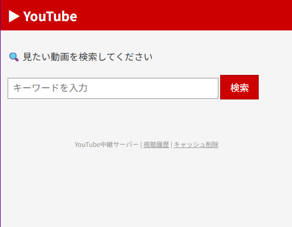
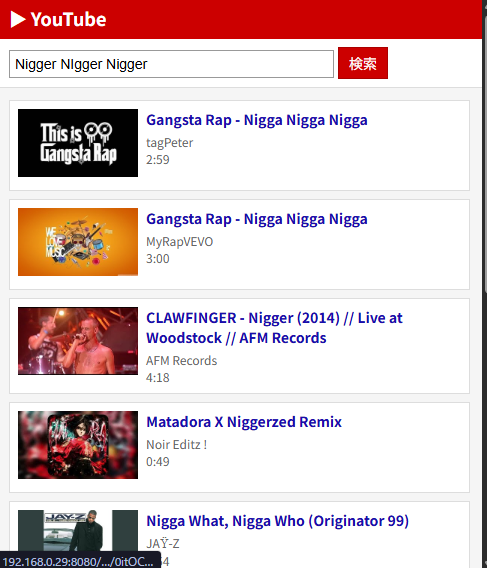
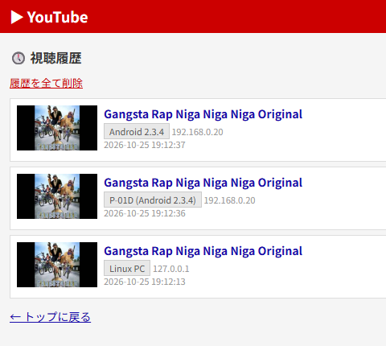

# YouTube中継サーバー

Android 2.3.x などの古い端末でYouTubeを視聴するための、自宅LAN内向け中継サーバーです。

## 仕組み

1. Android端末のブラウザからサーバーにアクセスして動画を検索
2. サーバーが **yt-dlp** でYouTubeから動画をダウンロード
3. **FFmpeg** で Android 2.3 互換形式（H.264 Baseline + AAC / MP4）に変換
4. LAN内の HTTP で端末に配信

古い端末が直接YouTubeに接続できない問題（TLS非対応・コーデック非対応）をすべてサーバー側で吸収します。

## 動作要件

- **サーバー側**: Linux（Python 3.8+, FFmpeg）
- **クライアント側**: ブラウザとメディアプレイヤーがあれば何でもOK（Android 2.3で動作確認済み）

## セットアップ

```bash
# 必要パッケージのインストール（Ubuntu/Debianの例）
sudo apt install python3 python3-pip python3-venv ffmpeg

# セットアップ
cd youtube-relay
chmod +x setup.sh start.sh
./setup.sh
```

## 使い方

```bash
./start.sh
```

起動後、表示されるURL（例: `http://192.168.1.10:8080`）にAndroid端末のブラウザでアクセスしてください。

## 機能

- **YouTube検索** — キーワードで動画を検索
- **自動変換** — H.264 Baseline Profile / AAC-LC / MP4 に自動変換
- **サムネイルプロキシ** — HTTPS非対応端末でもサムネイル表示
- **Range Requests** — 動画のシーク（早送り・巻き戻し）対応
- **キャッシュ** — 変換済み動画を保存、2回目以降は即再生
- **視聴履歴** — どの端末（機種名・Androidバージョン・IPアドレス）でいつ視聴されたかを記録・一覧表示

## スクリーンショット

### 1. トップページ（検索）


### 2. 検索結果一覧


### 3. 視聴履歴（端末表示）


## ファイアウォール設定

ポート8080を開放してください。

```bash
# Ubuntu (ufw)
sudo ufw allow 8080/tcp

# firewalld
sudo firewall-cmd --add-port=8080/tcp --permanent
sudo firewall-cmd --reload
```

## メンテナンス

```bash
# yt-dlpの更新（YouTubeの仕様変更時に必要）
./venv/bin/pip install --upgrade yt-dlp

# キャッシュ削除（ブラウザから）
# http://<サーバーIP>:8080/cache/clear
```

## ライセンス

MIT License — 詳細は [LICENSE](LICENSE) を参照してください。
